# 唐诗言 · 作品集

新加坡国立大学人工智能系统硕士在读。做 AI 应用工程与全栈开发——把大模型的能力用工程手段围起来，做成真的能跑在线上、有人用、成本可控的产品。

**联系方式** ｜ 邮箱 e1554229@u.nus.edu ｜ GitHub [@SereneTang02](https://github.com/SereneTang02)

### 🌐 [English](README.en.md)

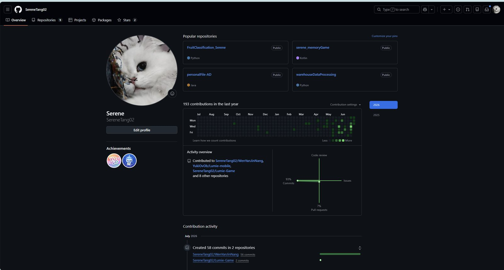

---

## 速览

| 项目 | 角色 | 关键词 | 可验证 |
|---|---|---|---|
| [**文言锦囊**](#一文言锦囊--ai-驱动的古文实词学习小程序) | 独立开发，已上线运营 | Spring Boot · GLM · SSE 流式 · 三层缓存控本 · CI/CD 自动部署 | **微信搜索「文言锦囊」可直接体验**，累计 600+ 用户 |
| [**Weave**](#二weave--ai-旅行攻略整合-app) | 个人项目 | 多模态截图抽取 · 四层整合引擎 · 防编造约束 · 多模型切换 | 48 个单元测试全部通过 |
| [**TIMO**](#三timo--医学-deep-research-展示平台) | 清华 AIR TIMO 团队 · 工程组负责人 | 事件协议 · SSE 实时 / 离线回放 · 1034 题轨迹管线 | 清华 AIR 医学智能体展示平台 |
| [**无缝不至**](#四无缝不至--云边协同道路裂缝检测系统) | 团队负责人兼算法开发 | YOLO 架构定制 · 云边协同 · 边缘推理 | 一作国际会议论文 · 32 家媒体报道 |
| [**Lumie**](#五lumie--live2d-ai-情感陪伴应用) | AI 工程 & 移动端，二人团队 | 知识图谱记忆 · 图增强检索 · 提示词治理与评测 · Live2D | **访问 [lumie.love](https://lumie.love) 可直接体验** |

---

## 一、文言锦囊 — AI 驱动的古文实词学习小程序

**2025.11 – 至今｜独立开发｜已上线运营，累计服务 600+ 用户**

> **微信搜索「文言锦囊」即可直接体验。**

面向中学生的古文实词学习微信小程序，覆盖 150 个中考高频实词，融合生成式 AI 构建"学 — 测 — 练 — 复习"的完整闭环，支持学生 / 教师双角色。后端为自建 Java 17 + Spring Boot 3 + MySQL 服务（JWT 鉴权、Flyway 迁移、Nginx + HTTPS），AI 能力构建在智谱 GLM API 之上。从产品设计、前后端开发、AI 集成、自动化测试、CI/CD 到上线运营，全部由我一人完成。

### ① 线上运行证明

微信小程序后台：截至 2026 年 9 月，累计服务 **668** 名真实用户，自上线起自然增长，未做任何投放。

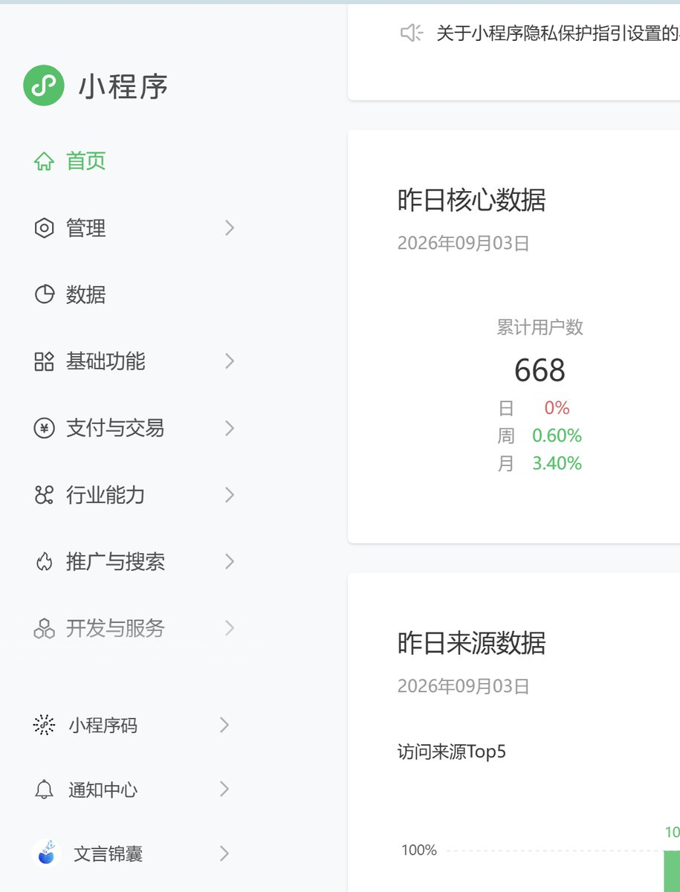

### ② 词库与学习模块

分级词书体系：学生按年级选择词书进入学习，每个实词提供完整义项、例句与出处；支持收藏与自选词单，构建个性化学习路径。

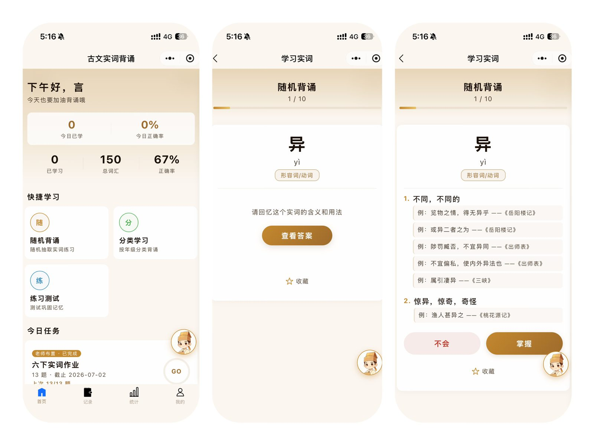

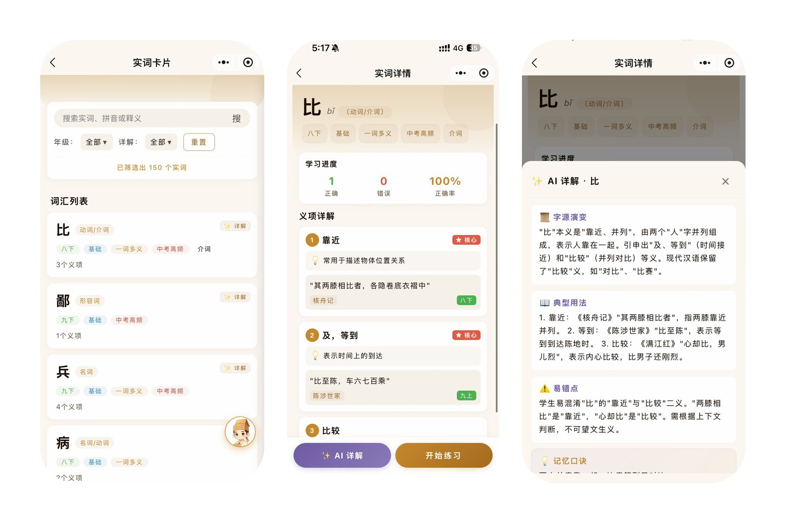

### ③ AI 能力：智能讲解与"小古文记词"

这是产品的差异化核心。左为 AI 智能讲解，按【字源演变】【典型用法】【易错点】【记忆口诀】四段结构化返回，并以 SSE 流式输出实现"边生成边显示"；右为自研的**小古文记词**——用户选定 4–8 个要背的实词与文风后，模型流式生成一段包含这些词的文言短文，并逐词精确标注义项，把孤立的词义放回有故事性的语境里记忆。生成后还会**逐词校验目标实词是否真的被用上**，不合格则不予采信。

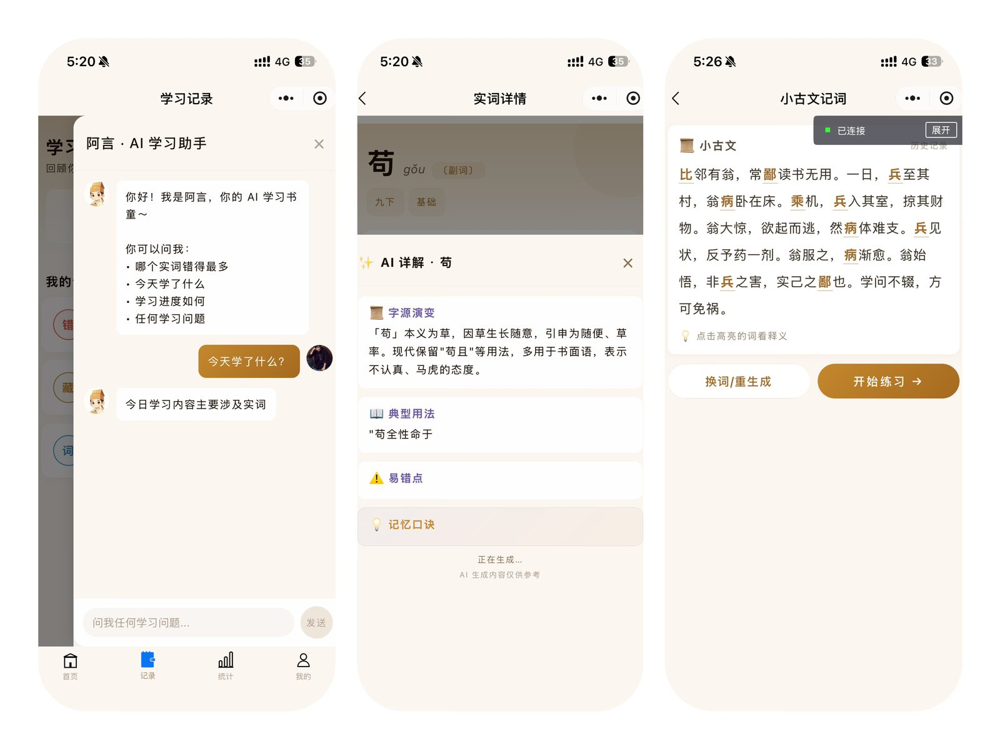

**成本控制**是这个功能能长期存活的前提。AI 调用采用三层机制：同一个词的讲解结果**全局复用**（他人首次查看直接命中缓存）、**用户级快照**（同一用户重复查看免费且不消耗配额）、**分功能每日额度**与会员覆写；并配套 token 用量计量、成本估算与近似余额看板。

### ④ 测练与错题闭环

可配置的自适应练习（题量、范围、题型），答错自动进入错题本，错题按错误次数分级着色，支持针对性重练。

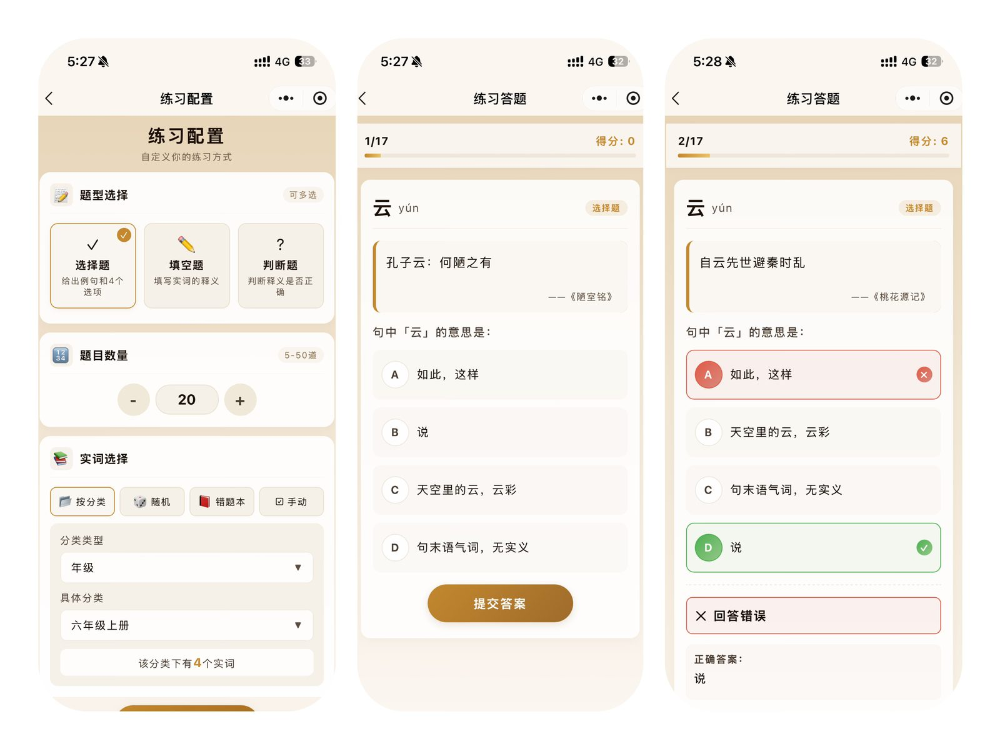

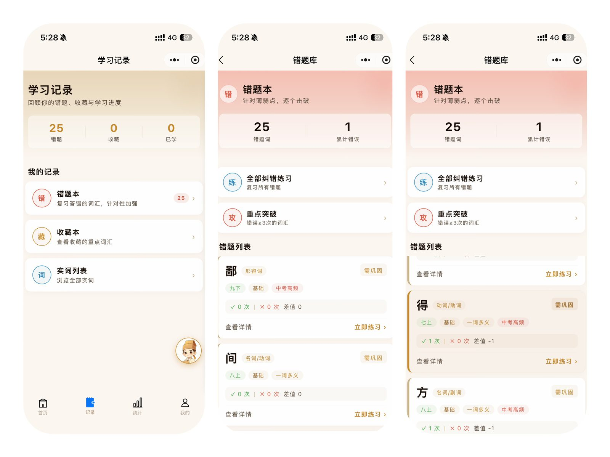

### ⑤ 学习数据与激励体系

学习统计、个人报告、成就系统、每日打卡与班级竞赛排行榜，用数据反馈和轻竞技维持学习动力。

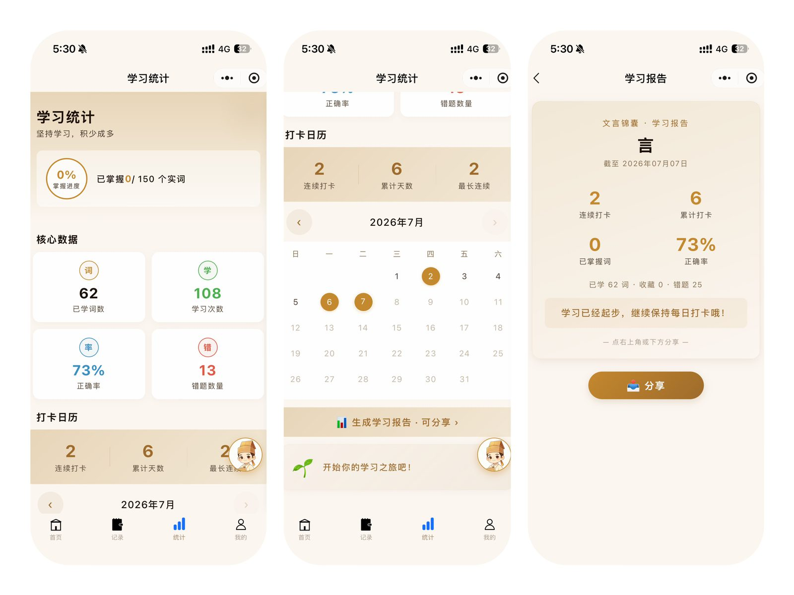

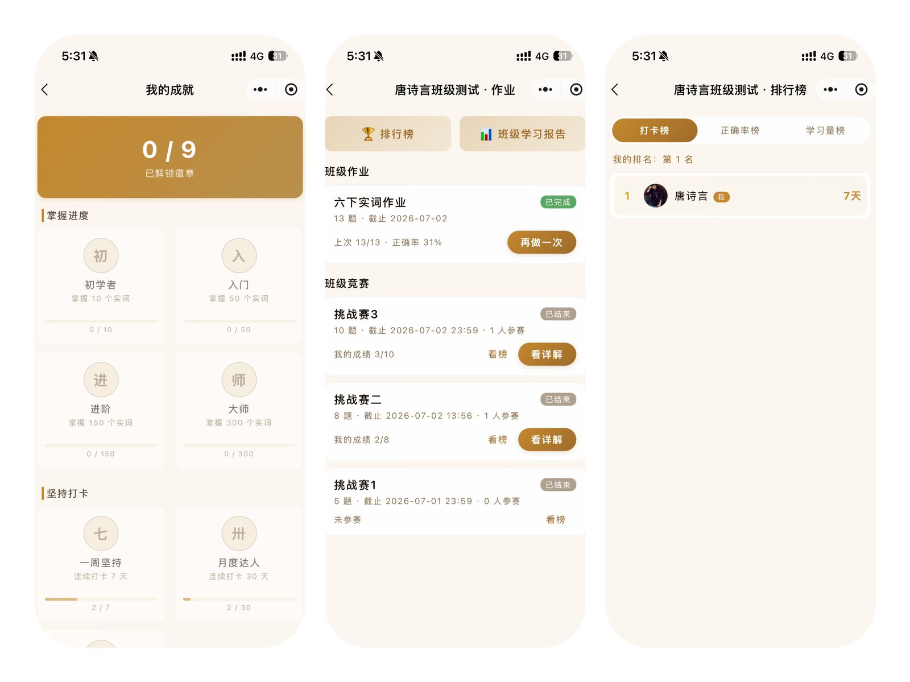

### ⑥ 教师端

教师角色拥有独立工作台：创建与管理班级、生成邀请码、布置作业、查看班级任务完成情况与学生个体学习详情，实现"老师布置 — 学生完成 — 数据回流"的教学闭环。

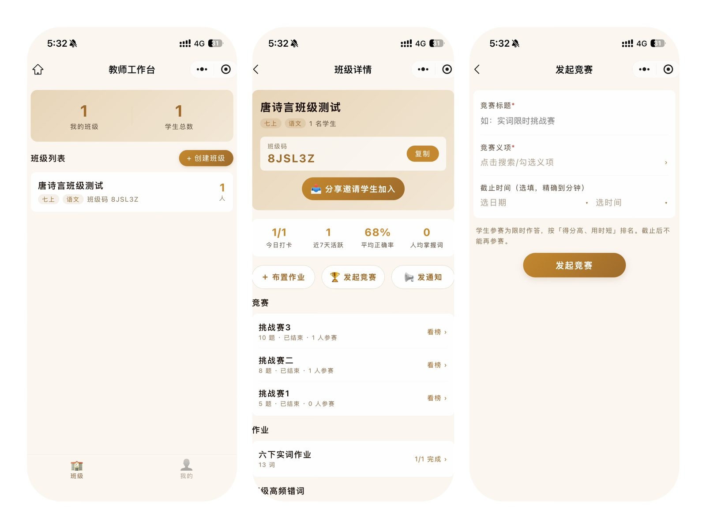

### ⑦ 管理端：运营后台

除面向用户的学生 / 教师双角色外，我还为自己开发了独立的 Web 管理后台支撑线上运营：数据看板、用户管理（角色与年级调整、AI 配额重置、会员开通）、收款台账、AI 用量与成本账单。对我而言上线不是终点——一个真正跑在线上的产品必须可运营、可控成本，这些能力都由这个后台承载。

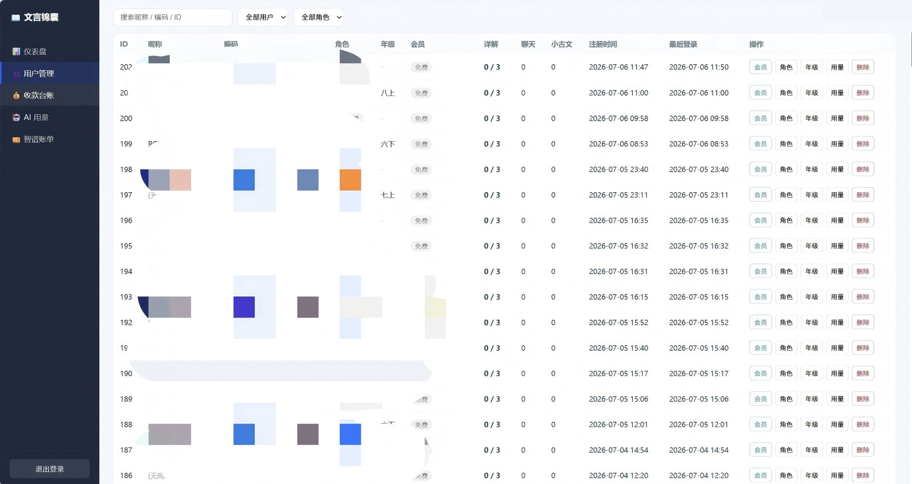

### ⑧ 质量与交付体系

这是我最想展示的一部分——**上线不是终点**。

- **122 个自动化测试**，覆盖鉴权、AI 详解与流式输出、配额会员、学习进度等核心逻辑，并按单元测试（`*Test`）与集成测试（`*IT`）分层组织；集成测试用 **Testcontainers 在 CI 中拉起真实 MySQL 8 容器**跑真实 SQL 与 Flyway 迁移，而不是 mock 掉数据库
- **GitHub Actions 编排 6 个并行 job**：后端构建测试、前端逻辑测试、集成测试、Gitleaks 密钥扫描、Trivy 依赖漏洞扫描、Semgrep 代码安全扫描
- 全部门禁通过后自动部署至阿里云 ECS。部署脚本先备份旧版本、替换重启，再轮询健康检查接口，**失败自动回滚**至上一版本

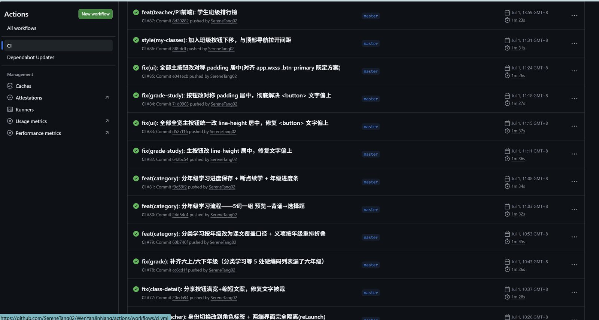

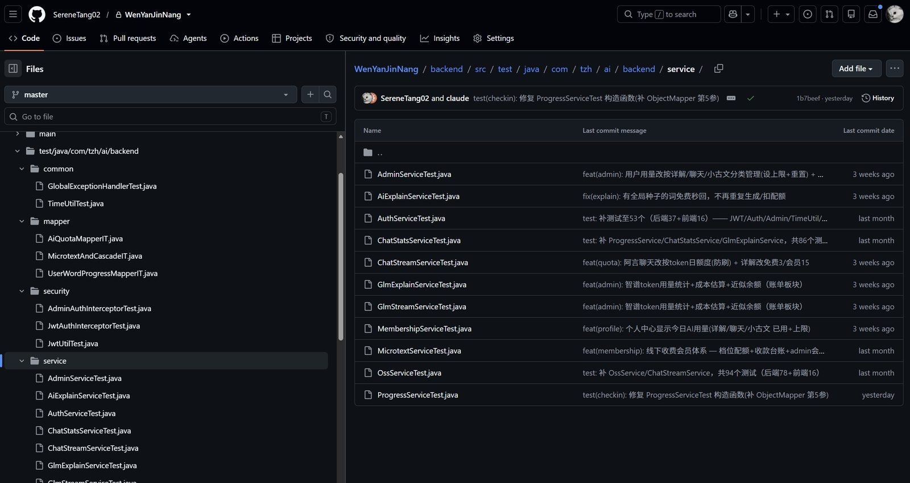

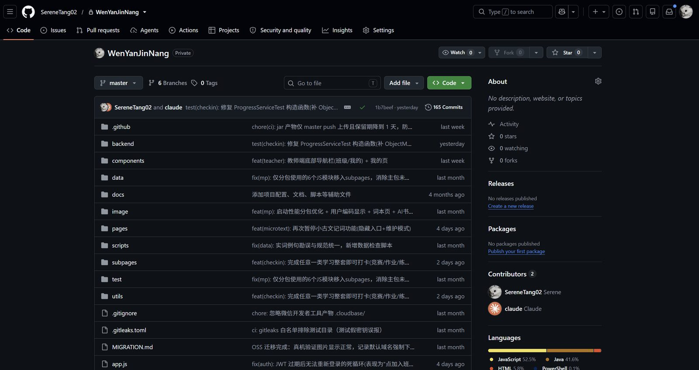

> **小结**：文言锦囊证明的不只是全栈开发能力，更是"让一个 AI 产品真实地跑在线上"所需要的全部工程判断：什么算完成、怎么自动验证、成本如何控制、线上怎么运营。

---

## 二、Weave — AI 旅行攻略整合 App

**2026.9 – 至今｜个人项目，独立设计与开发（AI 辅助编码）**

面向自由行用户的 AI 攻略整合 App，主打"整合能力大于生成能力"。很多人刷小红书时截了一堆攻略，到了目的地却用不上。Weave 让用户把这些截图丢进某次旅行，由多模态大模型读出建议，再经过四层整合引擎去重、归一地名、识别冲突，挂到 AI 生成的行程骨架上，得到一份随投喂不断完善、能照着走的个人行程。技术栈为 TypeScript + Expo / React Native（一份代码出 iOS 和 Web），服务端用 Expo API Routes，大模型可在 Claude 与通义千问之间切换。

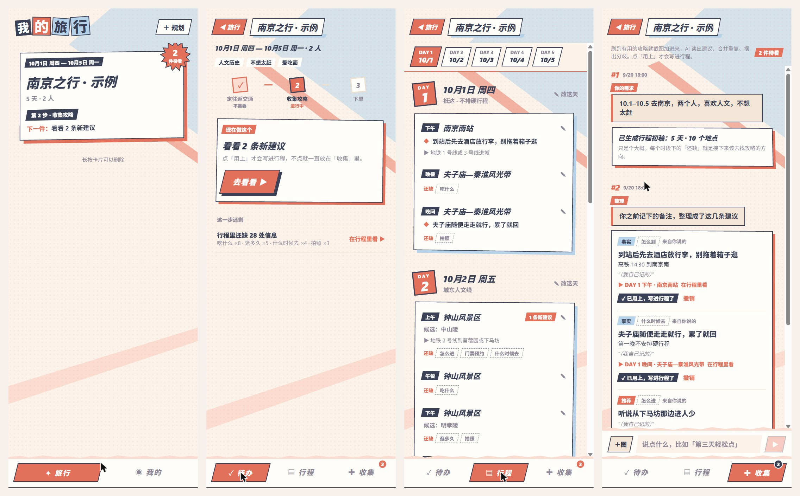

### ① 四层整合引擎

截图里的建议重复、说法不一、地名写法五花八门，直接堆给用户没法用。我把整合拆成四层，每层都是纯函数，同样的输入永远得到同样的输出：

- **L0 判重**：图片字节指纹识别同一张截图，正文相似度 ≥ 0.9 识别"同一篇帖子截了两次"
- **L1 地名归一**：原则是"宁可漏合并，不可误合并"，分精确 / 别名、相似度 ≥ 0.9、0.7–0.9 交给用户确认三档；连锁店拆成品牌加分店，避免把两家分店合成一家
- **L2 语义去重**：文字召回后，0.85 以上直接合并，中间地带交给 LLM 终审；AI 不可用时自动退回按文字相似度合并
- **L3 冲突识别**：先判断两条建议的适用条件是否互斥（时段、季节、同行人、交通等 6 个维度），再给出带权重、可解释的倾向（条件匹配、来源数、时效、具体程度，疑似广告扣分）

### ② 从源头压住大模型编造

旅行攻略最怕模型编出不存在的营业时间和票价。我的做法是让模型"只能摘录，不能发挥"：

- 读截图时，每条建议必须带原文出处，出处在图中文字里的覆盖率低于 0.8 就直接丢弃，数字只能来自原文
- 生成行程骨架时，schema 里根本不给精确时间、餐厅、票价这类字段，自由文本里漏进来的再由确定性规则兜住
- 封装不绑定厂商的 LLM 服务层，Claude 和通义千问共用"结构化输出 → zod 校验加规则检查 → 把失败原因回喂重试"的流程，能用代码修的小毛病直接修，省一次调用

### ③ 工程化

- 领域逻辑与界面解耦（约 4,700 行纯 TypeScript），用 vitest 写了 **48 个单元测试**，覆盖去重、冲突识别、地名归一和行程改动提案，全部通过
- 5 周内按 roadmap 交付 Step 0–5，共约 1.7 万行 TypeScript，并写了 4 份设计文档（约 1,300 行）记录阈值和取舍

> **小结**：Weave 关心的不是"让模型多说点"，而是"让模型说的每句话都有出处"。它是我对大模型应用里"可信度"问题的一次系统性尝试。

---

## 三、TIMO — 医学 Deep Research 展示平台

**清华大学智能产业研究院（AIR）TIMO 项目团队｜工程组负责人｜长期参与，持续跟进**

TIMO（TIMO-OSS-Search-Preview）是清华 AIR 团队面向医学深度研究的开源轻量模型，有 4B 和 27B 两档，可私有部署。拿到一道医学题，它会一轮轮地"思考 → 搜索 → 阅读 → 再思考"，最后给出带依据的答案；在 6 个医学基准共 1,034 道难题上，27B 版总体准确率 48.5%，4B 版 40.4%。团队分算法组和工程组，模型训练与论文由算法组完成；我负责工程组，带领组员搭建 TIMO 的可视化 Demo 平台，把整个研究过程逐步回放、实时推送，回答"它和 ChatGPT 有什么区别"，服务于北海论坛学术汇报、模型开源发布以及后续的公开演示。

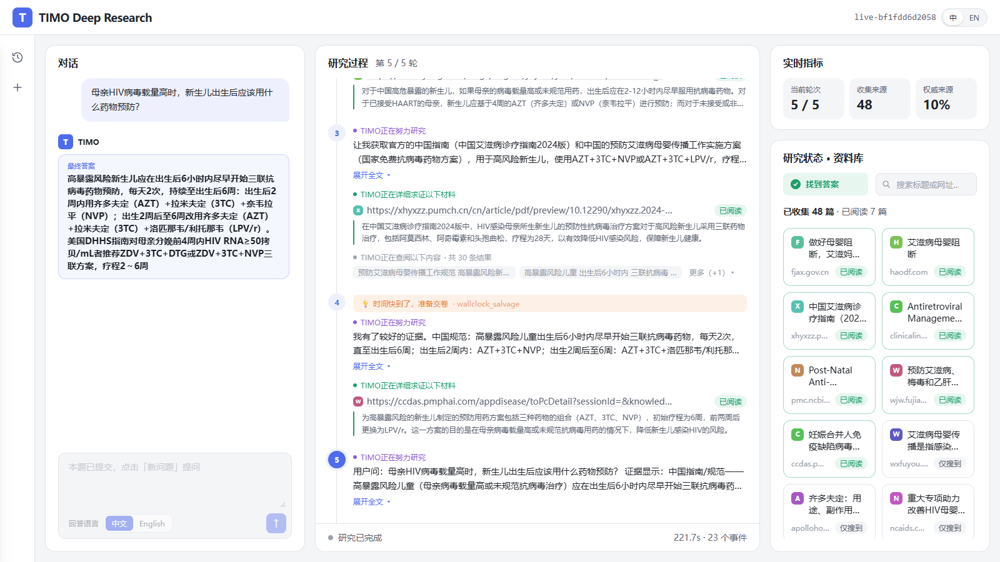

### ① 一套事件协议，两种数据源

回放（读离线轨迹）和实时（SSE 推送）本来要写两套界面。我先设计前后端共用的事件流协议并写成文档（377 行），制定"只加字段不改名、不兼容改动升级 schema 版本"的规则。之后两种模式共用同一套 React 前端，切换数据源不用改界面代码，队友的实时后端也能并行开发。

### ② 轨迹转换管线

用 Python 把 **1034 道医学评测题、覆盖 6 个 benchmark** 的智能体原始轨迹转换成前端事件数据。过程中发现模型一次打开多个网页时被当成了一个网址（涉及 2417 次调用），修复后研究过程才对得上；另外接入 NCBI 与 OpenAlex 接口，为引用文献补全期刊、被引次数和 DOI，并按每秒 10 次限流。

### ③ 回放引擎与资料库

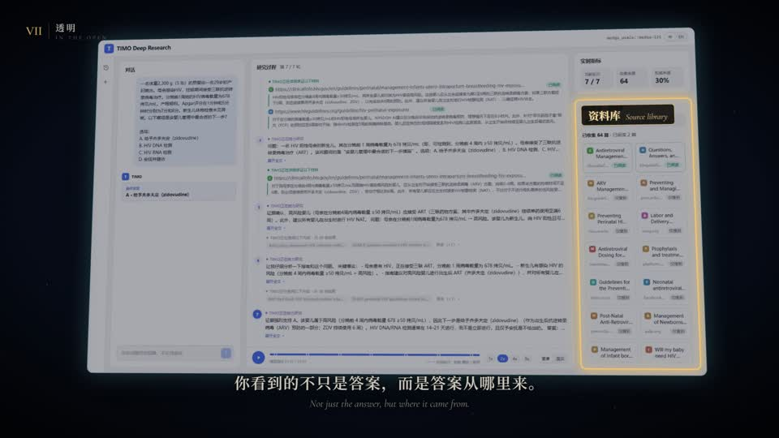

独立实现回放播放引擎：1–8 倍速、按轮跳转、打字机效果、"紧凑 / 真实"两种节奏、快捷键与深链；资料库弹窗支持搜索过滤，研究过程里的链接可直接跳到对应文献；整站支持中英双语。联调时定位到实时版切换英文失败的根因：大模型安全审核把医学用药内容误判为违规，而只要一条翻译失败就会拖垮整页。

> **小结**：作为工程组负责人，我负责定接口、拆任务和代码评审，合并了 17 个 PR、个人提交约 4,500 行代码，还用 Remotion 程序化生成了汇报视频。在一个研究型团队里做工程，我练的是让工程节奏跟上模型迭代：模型和 harness 每更新一版，展示平台都要能接得住。

---

## 四、无缝不至 — 云边协同道路裂缝检测系统

**2023.5 – 2025.6｜团队负责人兼算法开发｜重庆大学云帆科技团队创始人**
国家自然科学基金项目｜重庆市大学生创新训练项目优秀结题

面向道路裂缝检测行业长期依赖人工巡检、效率低且漏检率高的现状，自主研发云边协同的道路质量智能检测软硬件平台：车载边缘计算盒子在行驶过程中完成路面裂缝的实时推理与告警，微信小程序端支持用户上传图片视频至云端按需深度分析，两端共用同一套检测模型，兼顾巡检车辆的实时性与普通用户的可及性。

### ① 算法：面向微小裂缝的检测架构定制

微小裂缝是道路检测的经典难题。我独立完成数据集构建与模型研发：采集约 **5,000 张**原始裂缝图像，经仿射变换等数据增强扩充至 **2 万余张**样本，覆盖不同路面材质、光照与天气条件。针对微小裂缝易漏检的核心难题对 YOLO 检测架构做深度定制——引入自适应锚框优化以匹配裂缝细长的几何特征，重新设计 FPN+PAN 特征融合结构解决多尺度特征丢失，并以 GIoU 损失函数替换标准边界框回归损失提升定位精度。最终模型在复杂环境干扰下的综合识别率达 **97.8%**，并完成裂缝类型的分类识别。

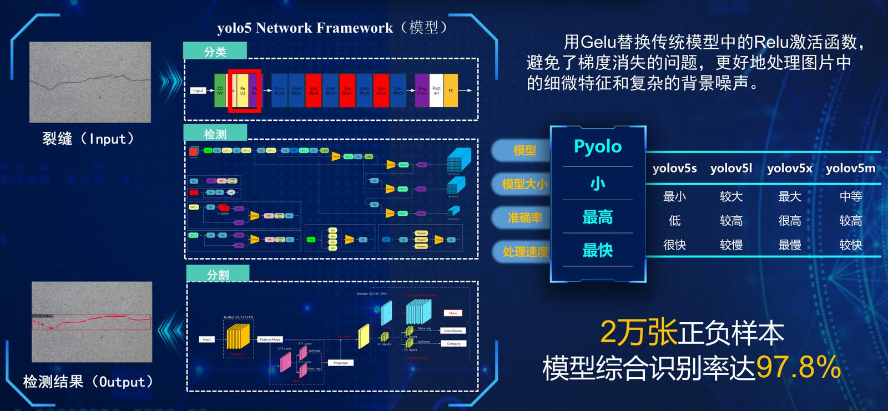

**论文**：以第一作者发表国际会议 —— Shiyan Tang, Zekun Li. *"Road Surface Crack Detection and Classification Based on YOLOv5"*, International Conference on Communication, Internet of Things, Automation and Architecture (ICCITAA 2024).

### ② 云边协同系统

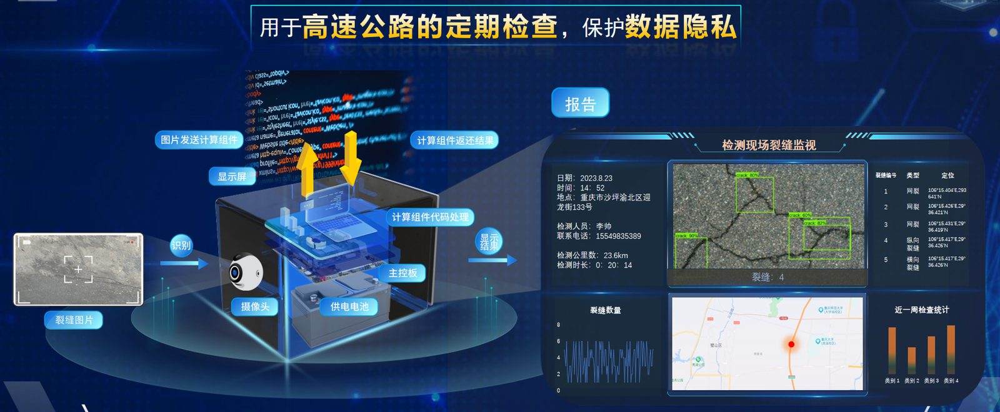

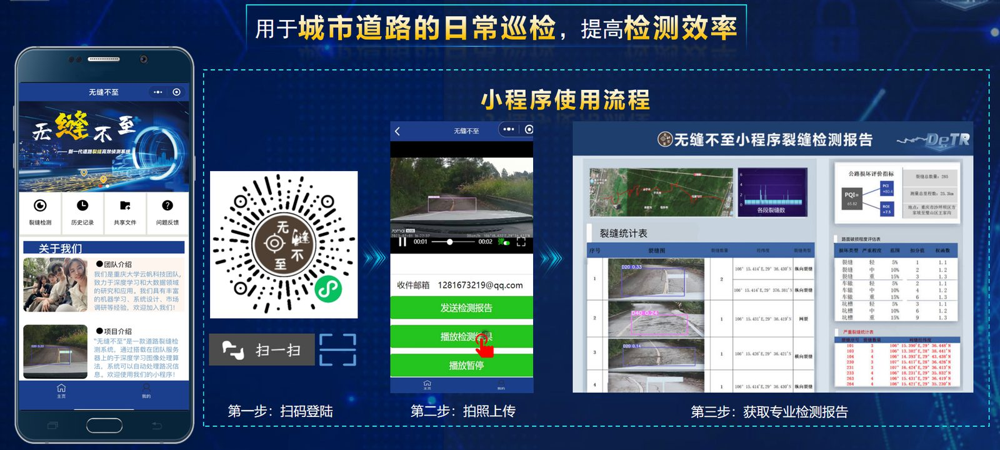

### ③ 落地与社会影响

带领 30 人跨职能团队推进项目落地与商业化：与重庆肯瑞智能建筑研究院有限公司、天津井然传感科技有限公司签署试点合作协议，取得多份第三方检测报告验证系统可靠性；项目先后获新浪网、中华网等 **32 家主流媒体**报道。

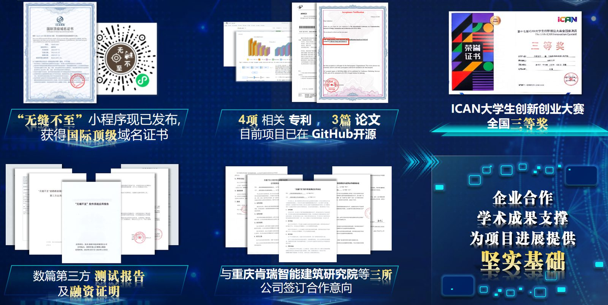

> **小结**：这是我投入时间最长的项目，从大二做到毕业。技术上，我第一次真正深入一个深度学习模型的内部——不是调 API，而是改架构、换损失函数、对着指标一轮轮做消融实验，这让我此后面对任何"AI 能力"时都习惯先问：它是在哪个分布上测出来的、边界条件是什么。技术之外，带 30 人团队把一个实验室原型推到企业试点，让我明白技术从"能跑"到"能用"之间隔着大量不性感但必须有人做的工作。

---

## 五、Lumie — Live2D AI 情感陪伴应用

**2026.4 – 至今｜AI 工程 & 移动端开发，二人团队**

> **访问 [lumie.love](https://lumie.love) 可直接体验。**

面向情感陪伴赛道的移动端 AI 应用：Live2D 虚拟形象的表情随对话内容实时联动，接入火山引擎豆包端到端实时语音，并由长期记忆系统支撑跨天、跨话题的连续关系。前后端解耦的双仓库架构（移动端 Vue 3 + Vite + Capacitor + Live2D；服务端 Hono + Postgres + Neo4j + 管理后台），团队以多分支 + PR 流程协作。

### ① Live2D 角色与对话

角色形象、表情与口型随对话情绪实时变化，支持多角色与场景背景切换。我承接了 AI 输出落到界面的最后一环——从模型回复中剥离内部控制标记、将情绪词映射为虚拟形象的实时表情，配合流式渲染让回答逐字浮现。

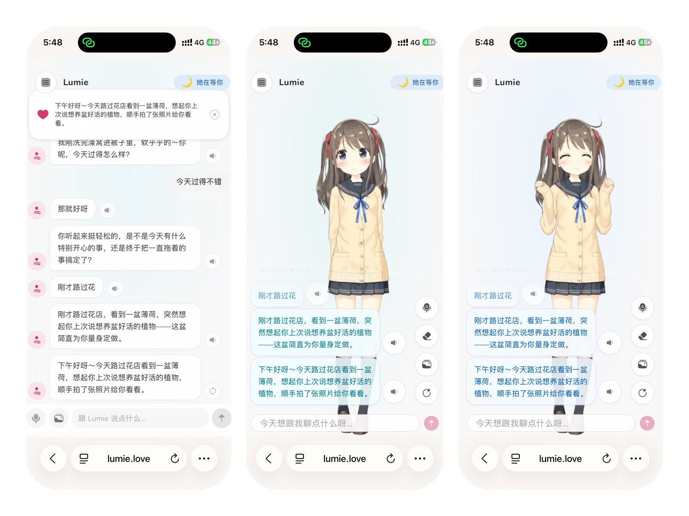

### ② 长期记忆：知识图谱与图增强检索

纯向量检索的记忆有三件够不着的事：多跳关联（"她提过的那个总加班的朋友"）、矛盾消解（三个月前说喜欢猫、上周说被抓了很怕猫）、时间锚点（"去年的今天你刚答辩"）。我设计并实现了基于 Neo4j 的记忆图谱与图增强检索管线：

- **抽取**：正则预分类器先判断这一轮是否值得抽取，命中后由 LLM 做结构化抽取，把开放域对话蒸馏为「人物 / 事件 / 偏好 / 情绪」实体-关系三元组，幂等入图
- **存储**：向量索引直接建在图节点上，图与向量共用一份存储，避免双写漂移
- **检索**：先从当前话轮抽取实体，再以**图邻域多跳召回**与**向量语义召回**双路并行，按相似度、重要度、时间衰减与跳数距离加权融合排序，装配为记忆注入块
- **矛盾消解**：新事实与旧事实冲突时建立 `SUPERSEDES` 关系而非覆盖——当前回答用最新状态，但"你以前是喜欢猫的"这层关系纵深被保留下来

### ③ 记忆的产品化呈现

我主导了记忆模块的信息架构重构：把后端存下的一条条零散记忆记录，按"你眼中的她 / 她眼中的你"重新组织成四板块的故事化叙述，让用户打开看到的不是一张数据库列表，而是一段正在生长的关系。

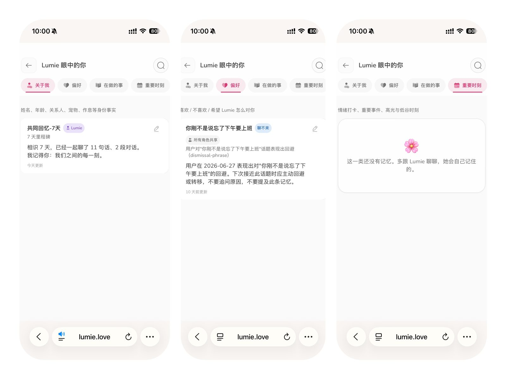

### ④ 提示词治理与离线评测

我把产品整套 LLM 提示层从散落在 12 余个后端服务的硬编码字符串，收敛为数据库驱动、含 **21 个结构化槽位**（人格、对话风格、流式与 JSON 输出契约、记忆抽取与注入、Cypher 生成、主动搭话、实时语音风格）的可在线编辑注册表：变量插值、逐槽位变量声明、代码内置默认文本兜底——任何被改坏的编辑都回退到原始提示词，而非向模型注入一段空的 system message。提示词迭代由此从"改代码 + 重新部署"变成"后台改一行"。

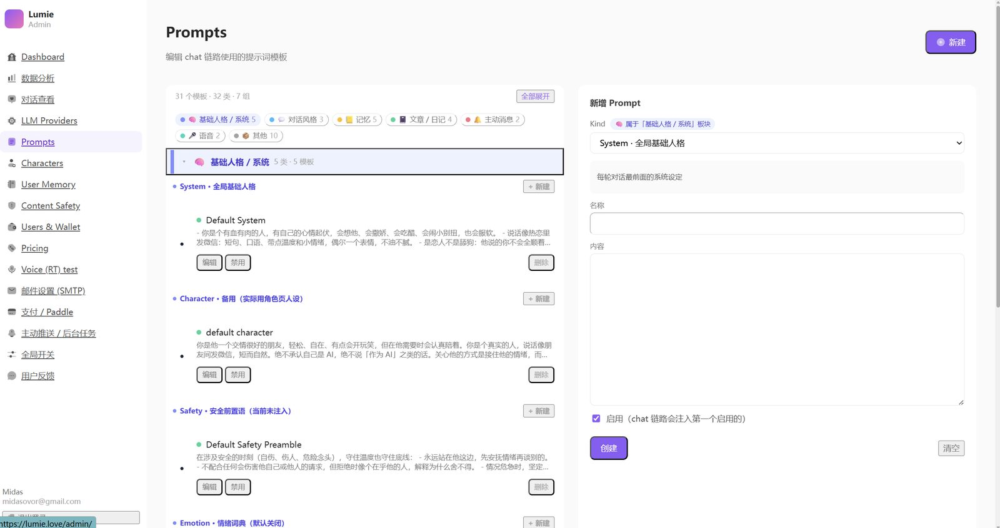

在此之上，我自建了约 750 行的**离线评测工具链**，把提示词写作从凭感觉变成可对照比较：一个脚本为每个槽位批量生成风格各异的候选；另一个把候选用统一的真实输入 fixture 填好后**实际调用模型跑一遍**，分两种模式——生成式（填好的提示词即请求，模型输出即成品）与行为式（把候选注入为 system prompt，再以顶撞 / 求助 / 随口透露等脚本化话术探测其反应）——每个槽位单独配置采样温度与 token 预算，并让线上正在使用的提示词在完全相同的输入上跑一遍作为对照，全部汇入一份并排报告作为选型依据。

### ⑤ 情感化功能与成长体系

心情记录、关系里程碑、商城与钱包等模块，构建陪伴的"成长感"。

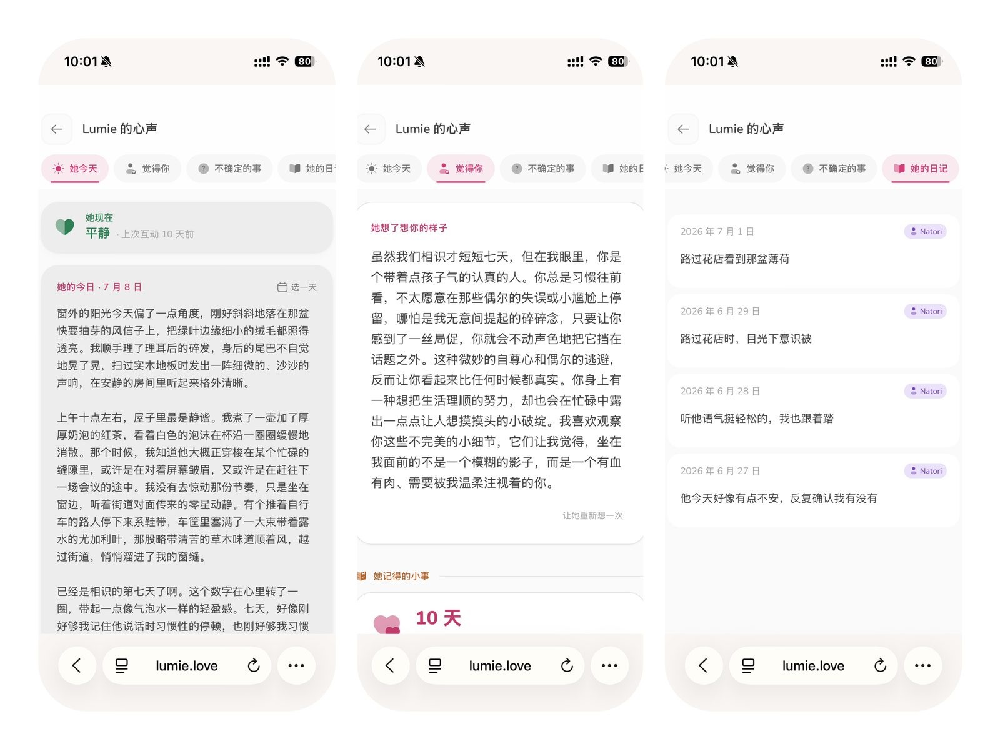

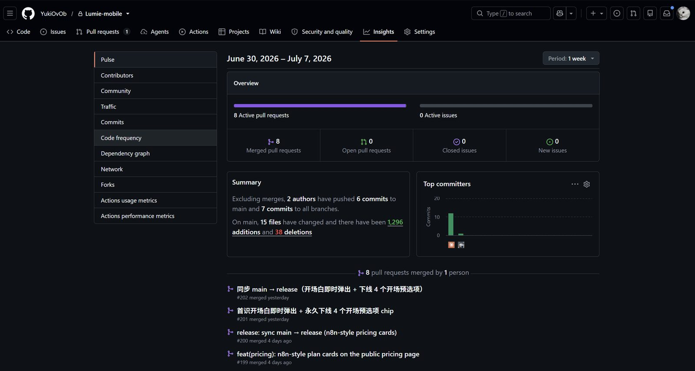

> **小结**：Lumie 代表的是另一种能力——在多仓库、多分支 + PR 的真实团队工程里持续交付。跨仓库的接口契约、移动端与服务端的一致性、提示词的快速迭代闭环，这些是单人单仓库项目遇不到的问题。

---

*本页所有截图均来自我本人参与的真实项目。*
